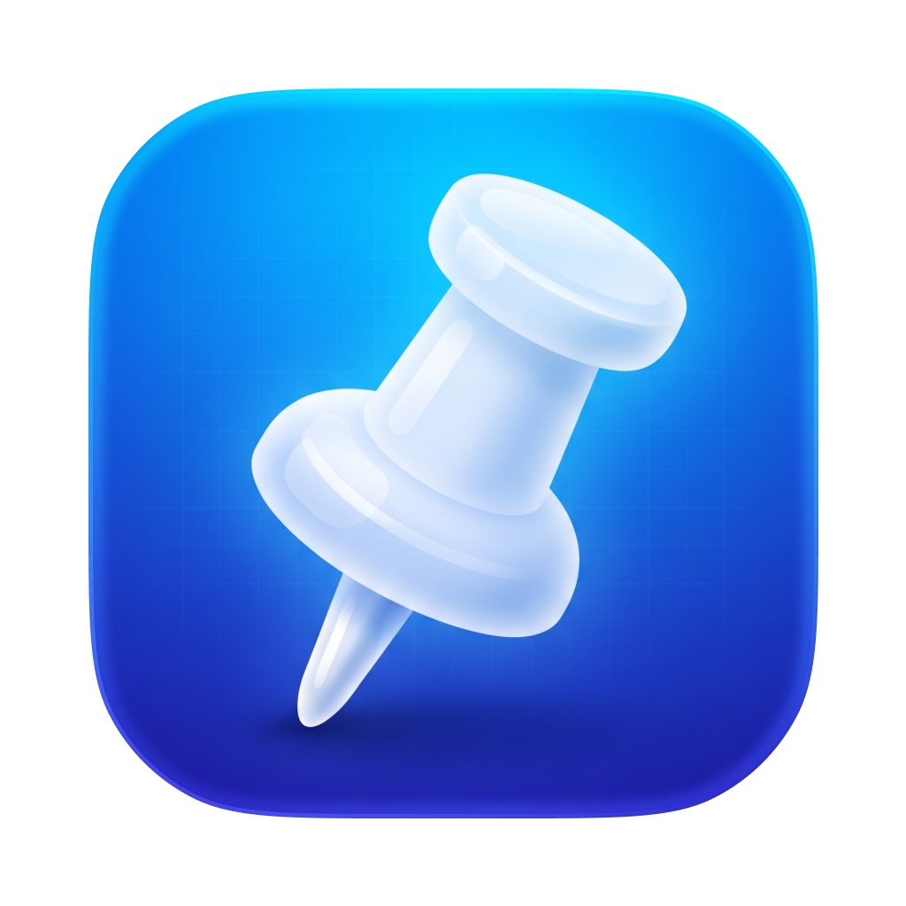

# Pinpin

A macOS menu bar app that keeps any window always on top. Press **⌥Space** on a window to pin it on top, and press it again to unpin it. Free, with no app window: everything lives in the menu bar.

## Install

Download the latest `Pinpin-x.y.z.dmg` from [Releases](https://github.com/bunkhq/Pinpin/releases/latest), open it, and drag **Pinpin** into **Applications**. It runs on Apple Silicon and Intel Macs.

Pinpin isn't signed with an Apple Developer ID, so macOS blocks it the first time you open it. To allow it:

1. Open Pinpin, and click **Done** when macOS says it can't verify it.
2. Go to **System Settings → Privacy & Security**, scroll down, and click **Open Anyway** next to the Pinpin message.

Or, in Terminal: `xattr -dr com.apple.quarantine /Applications/Pinpin.app`

Every release is signed with the same certificate, so Screen Recording and Accessibility stay granted when you update.

## Build & run

Requires macOS 14+ and the Swift toolchain (Command Line Tools are enough).

```sh
./scripts/build-app.sh --run   # builds build/Pinpin.app and launches it
```

**One-time signing setup:**

```sh
./scripts/setup-signing.sh
```

This creates a self-signed "Pinpin Local Signing" certificate in your login keychain, and `build-app.sh` signs every build with it. macOS ties privacy permissions to the app's signature, so a stable signature means you grant **Screen Recording** and **Accessibility** once and they survive rebuilds. Without it, builds are signed ad-hoc, and macOS treats each rebuild as a new app and asks again.

Pinpin only prompts for permissions on its first launch. After that, anything missing shows as a "Grant" banner in the dropdown. **Grant** checks with macOS first and does nothing if the permission is already there. Otherwise it asks whether you've already turned it on: if so, it relaunches Pinpin (Screen Recording only applies after a relaunch), or explains how to replace a stale entry. Once a permission has been granted, Pinpin remembers it and stops showing its banner. It only asks again if a pin actually fails without it.

## Releasing

Bump `CFBundleShortVersionString` (and `CFBundleVersion`) in `Resources/Info.plist`, commit, push, and run:

```sh
./scripts/release.sh               # build a universal DMG and publish GitHub release vX.Y.Z
./scripts/release.sh --no-publish  # same, but stop after build/Pinpin-X.Y.Z.dmg
```

## Using it

Click the pin in the menu bar to:

- **Record a new hotkey** (the default is ⌥Space; ↺ resets it)
- **Turn sound effects and notifications on or off** separately. Each toggle plays a soft chime (rising for on, falling for off) and shows a small blue "Activated" or red "Deactivated" pill at the bottom of the screen for about a second.
- **Focus pinned windows on hover** (off by default). Resting the pointer on a pinned window focuses it, so your first click or keystroke goes straight to it. If you leave without clicking or typing, focus goes back to the window you were using. Where pinned windows overlap, the one with the highest pin number wins. Hover focus pauses while the Pinpin dropdown is open.
- **Open at login** (on by default; also listed in System Settings → General → Login Items)
- **Pin any window** by clicking it in the list; pinned windows are highlighted blue, show their pin number, and sit at the top of the list in pin order. Other windows follow, most recently focused first. Unpinned windows on other desktops or minimized windows are listed in their own section, and pinning one brings it to you. The dropdown stays open and on top while you pin.
- **Unpin all windows** at once

## How it works

macOS doesn't let one app change another app's window level without disabling SIP. Pinpin does this instead:

1. Streams each pinned window with **ScreenCaptureKit** and keeps a floating, click-through panel exactly over it.
2. Whenever you might be using another window, the panel shows a **live mirror** of the pinned window, so it stays on top with no fade or flash. That covers any click outside the pinned window, any app switch (including ⌘Tab), and any time another window overlaps it. The mirror goes up *before* macOS reorders the windows.
3. **Pins are numbered** in the order you pin them (1, 2, 3…), and a higher number always sits above a lower one, whichever window has focus. Unpinning a window closes the gap: unpin #3 of 5 and #4 and #5 become #3 and #4. Only the window you're working in is shown for real; the others are mirrors stacked by number, with holes cut in lower mirrors where a higher pinned window is shown for real.
4. **Clicking the mirror** focuses the real window (via Accessibility). The mirror stays up until the real window is actually in front, then gets out of the way so you're working with the real window.

Known limits: with hover focus off, the mirror is view-only until you click it, so scrolling a pinned window while another app is focused doesn't reach it, and the first click focuses the window rather than passing through to whatever you clicked. Turn on hover focus to avoid both. Pins don't persist across relaunches.

## Layout

| File | Purpose |
| --- | --- |
| `PinpinApp.swift` | App entry point and launch setup |
| `StatusItemController.swift` | Menu bar button and the dropdown panel, which resizes to its content |
| `MenuView.swift` | Dropdown UI: settings, window list, Unpin All |
| `PinManager.swift` | Pinned state, hotkey action, window tracking and occlusion |
| `HoverFocus.swift` | Focus pinned windows on hover, and hand focus back on leave |
| `PinOverlay.swift` | Per-window overlay panel with the live mirror |
| `HotKeyCenter.swift` / `Shortcut.swift` / `Settings.swift` | Global hotkey (Carbon), settings, login item |
| `Feedback.swift` | Synthesized toggle sounds and the bottom-of-screen toast |
| `WindowList.swift` / `Permissions.swift` | Window enumeration, coordinates, permissions, focusing |

## License

MIT. See [LICENSE](LICENSE).
