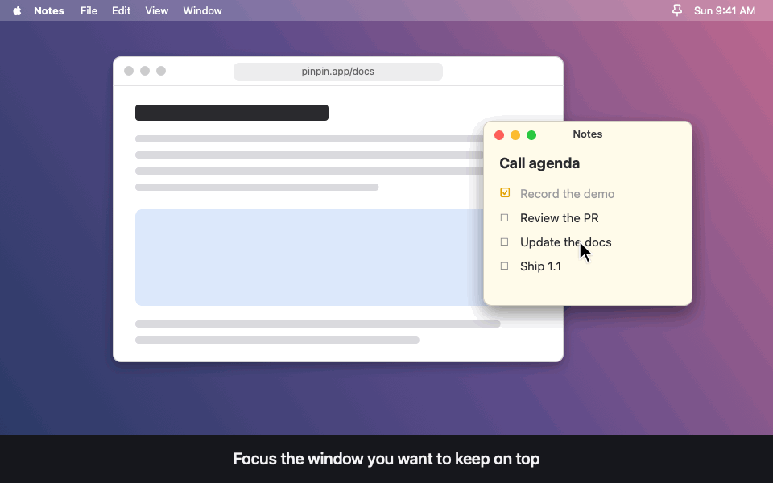

<div align="center">


# Pinpin

**Keep any window on top on macOS.**

Press **⌥Space** to pin a window on top. Press it again to unpin it.

[](https://github.com/bunkhq/Pinpin/releases/latest)
[](#requirements)
[](LICENSE)

[Download](https://github.com/bunkhq/Pinpin/releases/latest) · [Usage](docs/USAGE.md) · [Permissions](docs/PERMISSIONS.md) · [How it works](docs/HOW-IT-WORKS.md)



</div>

---

## Features

- **Pin any window** with a global hotkey or from the menu bar list.
- **Pin several windows.** Pins are numbered, and a higher number always stays above a lower one.
- **Focus on hover** (optional). Pointing at a pinned window gives it focus, and focus goes back when you move away.
- **Menu bar only.** Pinpin has no Dock icon and no app window.
- **Universal app** for Apple Silicon and Intel Macs.

## Requirements

- macOS 14 Sonoma or later
- **Screen Recording** and **Accessibility** permissions. See [Permissions](docs/PERMISSIONS.md) for what each one is used for.

## Install

1. Download `Pinpin-x.y.z.dmg` from the [latest release](https://github.com/bunkhq/Pinpin/releases/latest).
2. Open the DMG and drag **Pinpin** into **Applications**.
3. Open Pinpin. Pinpin isn't signed with an Apple Developer ID, so macOS blocks the first launch. Click **Done**, then go to **System Settings → Privacy & Security** and click **Open Anyway**.

You can skip step 3 by running this in Terminal instead:

```sh
xattr -dr com.apple.quarantine /Applications/Pinpin.app
```

## Quick start

1. Focus the window you want to keep on top and press **⌥Space**.
2. Press **⌥Space** on that window again to unpin it.
3. To pin from a list, change the hotkey, or adjust settings, click the pin icon in the menu bar.

See [Usage](docs/USAGE.md) for every feature and setting.

## Documentation

| Guide | Contents |
| --- | --- |
| [Usage](docs/USAGE.md) | Hotkey, menu bar dropdown, pin numbering, focus on hover, settings |
| [Permissions](docs/PERMISSIONS.md) | Why Pinpin needs each permission, granting it, and fixing stale grants |
| [How it works](docs/HOW-IT-WORKS.md) | How Pinpin keeps windows on top, and its known limitations |
| [Development](docs/DEVELOPMENT.md) | Building from source, code signing, releasing, code layout |

## Contributing

Bug reports, ideas and pull requests are welcome. See [CONTRIBUTING.md](CONTRIBUTING.md) to get started, or pick up a [good first issue](https://github.com/bunkhq/Pinpin/labels/good%20first%20issue).

If Pinpin is useful to you, a ⭐ helps other people find it.

## License

MIT. See [LICENSE](LICENSE).
